<!--
  EMON-721 / EMON-721 — public GitHub profile README
  Research Interface v4 — updated 25 October 2026.
  Every section below is deliberately editable. See EDITING_GUIDE.md.
  IMPORTANT: Do not publish private repositories, credentials, financial data,
  transcripts, or unverified publication / contribution figures in this public repo.
-->

<!-- ================ HERO: REAL PORTRAIT, ANIMATED DESIGN ================ -->
<table>
<tr>
<td width="72%" valign="top"><a href="https://github.com/EMON-721/EMON-721/edit/main/README.md">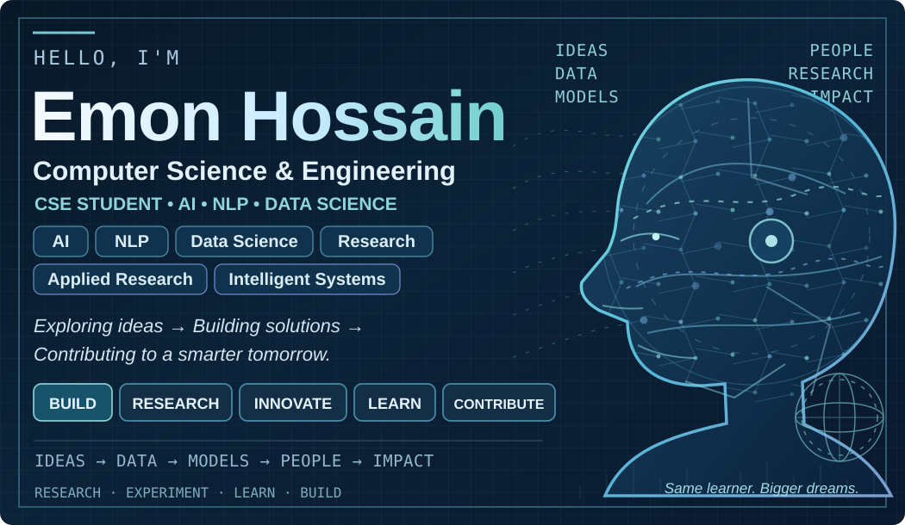</a></td>
<td width="28%" valign="middle" align="center">
<b>Emon Hossain</b> EMON-721 · CSE Student · Dhaka, Bangladesh
</td>
</tr>
</table>

**Computer Science & Engineering (CSE) Student | AI • ML • NLP • Data Science | Research-Driven**

Exploring how machines learn, understand language, and turn data into useful insights.

[**Build / Projects**](https://github.com/EMON-721?tab=repositories) · [**Research**](#01--research--animated-concept-map) · [**Learn & Innovate**](#03--interests--research-directions) · [**Collaborate**](#08--connect-with-me--open-to-collaboration)

---

<!-- ================ RESEARCH CONCEPT MAP: EDIT assets/research-concept-map.svg ================ -->
## 01 / Research · Animated concept map

  
  Five rotating research modes · flowing signal paths · four stages and twelve nodes · conceptual visualization, not live model inference.

The concept map uses **SVG animation without JavaScript**, with an always-visible connected-node flow inspired by the earlier reference. GitHub profile READMEs cannot run interactive React or JavaScript tabs, so use the expanding panels below to view a specific subject on demand.

<b>01 · Machine Learning — Input → Features → Model → Insight</b>

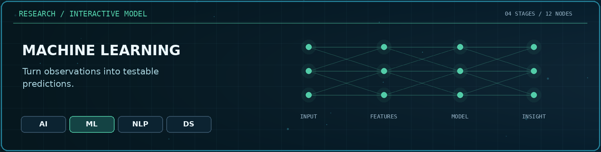

Experimentation, pattern discovery, evaluation, prediction, and explainability.

<b>02 · Artificial Intelligence — Data → Represent → Reason → Impact</b>

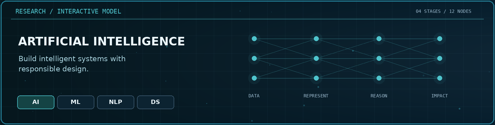

Applied intelligence, reasoning, human-centered AI and responsible systems.

<b>03 · Language & NLP — Text → Tokens → Context → Meaning</b>

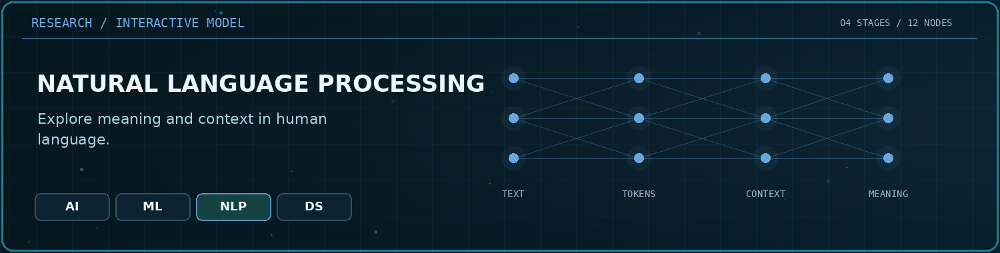

Text understanding, multilingual NLP, information retrieval, transformers and RAG.

<b>04 · Big Data — Ingest → Store → Process → Insight</b>

Data engineering at scale: structured/unstructured sources, distributed storage, batch/stream processing, quality checks, and analysis. The five-mode animated concept map above includes this Big Data flow.

<b>05 · Data Science — Collect → Clean → Analyse → Impact</b>

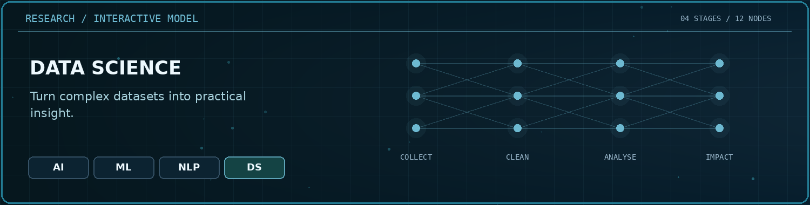

Statistical inquiry, feature analysis, useful visualizations and reproducible evidence.

<b>Previous research cycle · optional archive</b>

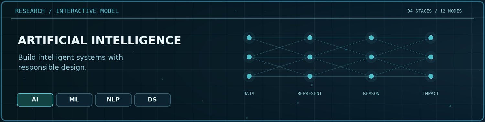

**[Edit research content](https://github.com/EMON-721/EMON-721/edit/main/README.md)** · **[Manage animation source](https://github.com/EMON-721/EMON-721/blob/main/assets/research-concept-map.svg)**

---

<!-- ================ ABOUT / EDUCATION / RESEARCH: EDITABLE ================ -->
## 02 / About Me · Education · Research Background

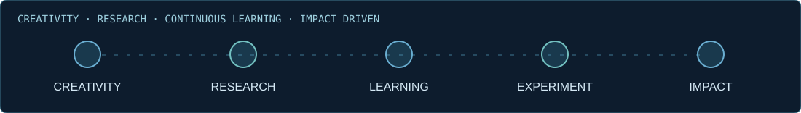

<table><tr><td width="33%" valign="top">
<h3>About Me</h3>

I'm <b>Emon Hossain</b>, a <b>Computer Science &amp; Engineering (CSE) student</b>. My interests and academic work focus primarily on <b>Artificial Intelligence, Machine Learning, Natural Language Processing and Data Science</b>.

I enjoy exploring research problems, testing ideas, working with data and building intelligent solutions. I completed a software engineering coursework project, but software development is not my primary specialization.

Creativity · Research-oriented · Continuous learner · Impact-driven

<a href="https://github.com/EMON-721/EMON-721/edit/main/README.md">✎ Edit · ＋ Add Strength</a>

</td><td width="34%" valign="top">
<h3>Education</h3>
 

<b>B.Sc. in Computer Science &amp; Engineering</b> University of Liberal Arts Bangladesh (ULAB) Dhaka, Bangladesh · <b>In progress</b>

<a href="https://github.com/EMON-721/EMON-721/edit/main/README.md">✎ Update · ＋ Add Education</a>

</td><td width="33%" valign="top">
<h3>Research Background</h3>

My research interests involve how machines learn patterns from data, how language models process information, and how datasets can support reproducible experiments and useful decisions.

Core directions: <b>AI/ML model evaluation, NLP and retrieval/RAG, multilingual language processing, exploratory Data Science, responsible AI</b> and sustainability-related datasets.

<a href="#06--research--publications">Research and publications ↗</a>

</td></tr></table>

---

<!-- ================ INTERESTS & CURRENT FOCUS ================ -->
## 03 / Interests · Research Directions

<code>Artificial Intelligence</code> · <code>Machine Learning</code> · <code>Language &amp; NLP</code> · <code>Data Science</code> · <code>Big Data</code> · <code>Deep Learning</code> · <code>Information Retrieval</code> · <code>Applied Research</code> · <code>Responsible AI</code> · <code>Sustainability</code>

<table><tr><td width="50%" valign="top">
<h3>Current focus</h3>
<ul>
<li>Machine Learning training, testing and evaluation</li>
<li>Natural Language Processing, retrieval and RAG</li>
<li>Data analysis, cleaning and visualization</li>
<li>Publicly available datasets and research experiments</li>
</ul>
</td><td width="50%" valign="top">
<h3>Research interests</h3>
<ul>
<li>Multilingual and low-resource language technology</li>
<li>Intelligent systems and explainable results</li>
<li>Ethical AI and reproducible methods</li>
<li>AI applications for environmental and sustainability data</li>
</ul>
</td></tr></table>

<a href="https://github.com/EMON-721/EMON-721/edit/main/README.md">✎ Edit · ＋ Add Interest · ↕ Reorder</a>

---

<!-- ================ SKILLS & VERIFIED SELF-DESCRIBED TOOLS ================ -->
## 04 / Technical Skills · Tools

| Skills you identified | Research-related work |
| --- | --- |
| HTML5 · CSS3 · JavaScript · TypeScript | AI / ML · NLP · Data Science |
| Python · MySQL | Data handling · Model evaluation |
| Git · GitHub | Version control · Experiments |
| Jira · Atlassian | Project tracking and collaboration |

My main focus is research in AI/ML, NLP and Data Science; the technical stack reflects skills and tools rather than a claim to be a full-stack developer.

<a href="https://github.com/EMON-721/EMON-721/edit/main/README.md">✎ Edit · ＋ Add Skill · ↕ Reorder</a>

---

<!-- ================ PROJECTS: ALL CONNECTED REPOSITORIES, ANIMATED ================ -->
## 05 / Featured Repositories · Projects

Connected GitHub access currently confirms <b>13 repositories (7 public and 6 private)</b>. Campus to Country is first, followed by Mouchak AI, FixBari, GoliCoach AI and Emon Portfolio. Service Lagbe is shown at the bottom of the repository cards. This is a curated showcase, not a complete list of all accessible repositories. This count is only the current accessible inventory; previously created or disconnected repositories may not appear.

<table>
<tr><td width="50%" valign="top"><a href="https://github.com/EMON-721/campus-to-country">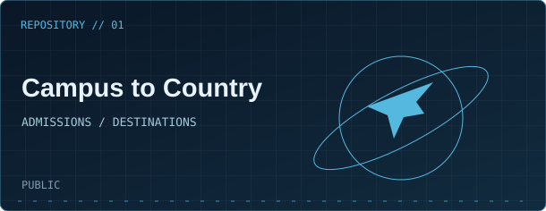</a>
<b><a href="https://github.com/EMON-721/campus-to-country">Campus to Country</a></b> · Public

Destination and application planning platform.
</td><td width="50%" valign="top"><a href="https://github.com/EMON-721/Mouchak-AI-platform">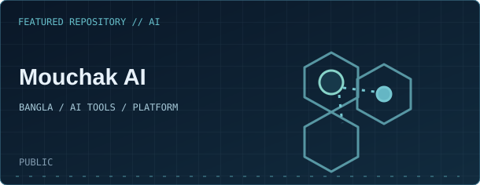</a>
<b><a href="https://github.com/EMON-721/Mouchak-AI-platform">Mouchak AI</a></b> · Public

Bangla–English AI platform with 50 specialized tool workspaces for practical everyday needs.
</td></tr>
<tr><td width="50%" valign="top"><a href="https://github.com/EMON-721/FixBari">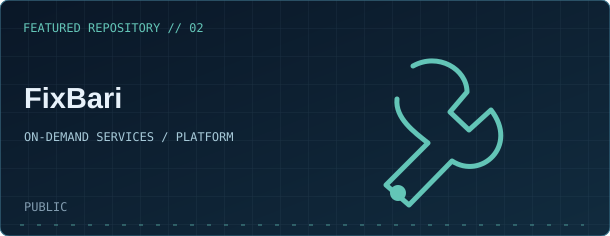</a>
<b><a href="https://github.com/EMON-721/FixBari">FixBari</a></b> · Public

Local service marketplace for bookings, quotations and technicians.
</td><td width="50%" valign="top"><a href="https://github.com/EMON-721/Goli-Coach">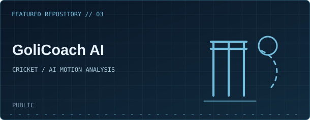</a>
<b><a href="https://github.com/EMON-721/Goli-Coach">GoliCoach AI</a></b> · Public

AI-assisted cricket practice with pose analysis and feedback.
</td></tr>
<tr><td width="50%" valign="top"><a href="https://github.com/EMON-721/Emon-Portfolio">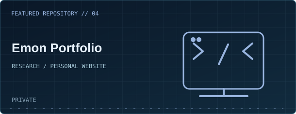</a>
<b><a href="https://github.com/EMON-721/Emon-Portfolio">Emon Portfolio</a></b> · Private

Personal academic portfolio featuring research, projects and animated sections.

Repository visible only to authorized GitHub accounts.
</td><td width="50%" valign="top"><a href="https://github.com/EMON-721/EMON-721/edit/main/README.md">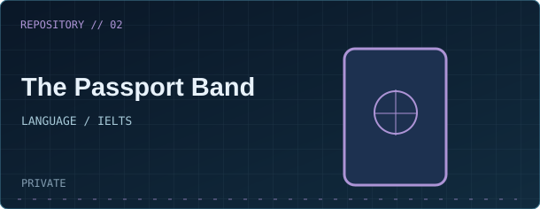</a>
<b>The Passport Band</b> · Private

IELTS Academic practice, vocabulary and learning activities.
</td></tr>
<tr><td width="50%" valign="top"><a href="https://github.com/EMON-721/EMON-721/edit/main/README.md">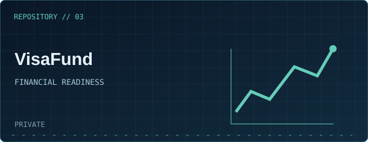</a>
<b>VisaFund</b> · Private

Financial planning, account tracking and readiness tools.
</td><td width="50%" valign="top"><a href="https://github.com/EMON-721/EMON-721/edit/main/README.md">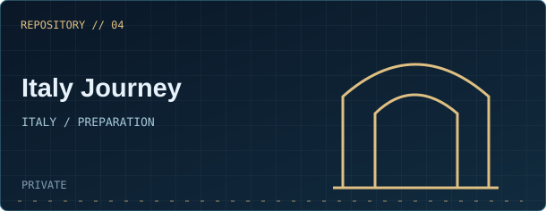</a>
<b>Italy Journey</b> · Private

Italy admissions research and application planning.
</td></tr>
<tr><td width="50%" valign="top"><a href="https://github.com/EMON-721/EMON-721/edit/main/README.md">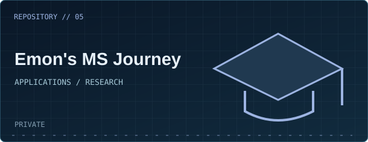</a>
<b>Emon's MS Journey</b> · Private

Master's application research and personal milestone tracking.
</td><td width="50%" valign="top"><a href="https://github.com/EMON-721/EMON-721">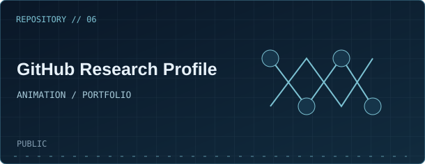</a>
<b><a href="https://github.com/EMON-721/EMON-721">GitHub Research Profile</a></b> · Public

Animated profile presentation and research concept map.
</td></tr>
<tr><td width="50%" valign="top"><a href="https://github.com/EMON-721/vocab-station">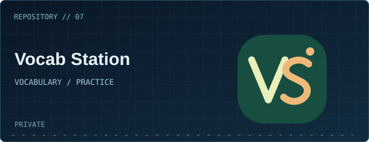</a>
<b><a href="https://github.com/EMON-721/vocab-station">Vocab Station</a></b> · Private

English vocabulary learning, daily practice, mock tests, revision and progress tracking.
</td><td width="50%" valign="top"><a href="https://github.com/EMON-721/Service-Lagbe">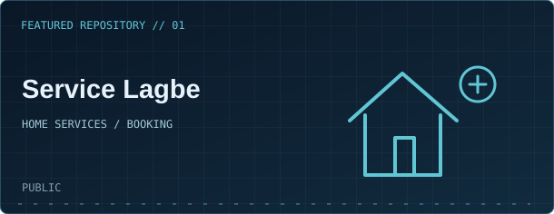</a>
<b><a href="https://github.com/EMON-721/Service-Lagbe">Service Lagbe</a></b> · Public

Home-service booking with customer, technician and admin workflows.
</td></tr>
<tr><td width="50%" valign="top"><h3>＋ Add New Project</h3>
Add another public repository, verified coursework project, research experiment or new application when available.
<a href="https://github.com/EMON-721/EMON-721/edit/main/README.md">＋ Add · ✎ Edit · ↕ Reorder</a></td><td width="50%" valign="top"><h3>Future Project Slot</h3>
Additional verified projects can be added here without modifying existing animation or cards.
</td></tr>
<tr><td width="50%" valign="top"><h3>Software Engineering Coursework</h3>
I have completed a software-engineering coursework project. Its repository title and details can be added when verified.
<a href="https://github.com/EMON-721/EMON-721/edit/main/README.md">＋ Add Coursework Details</a></td><td width="50%" valign="top">More verified projects can be added here without changing the existing research animations.</td></tr>
</table>

Private project source code has not been exposed, and no imaginary stars, fork counts or publication details are displayed.

---

<!-- ================ PUBLICATIONS: KEEP ONLY VERIFIED SOURCES ================ -->
## 06 / Research & publications

**Research directions:** Artificial Intelligence · Machine Learning · Language & NLP · Data Science · Big Data · Intelligent Systems · Sustainability.

I explore research questions, practical evaluations and dataset-based experimentation. Publication records will be displayed here after verifying official paper titles, author details, venues and DOIs; no unverified publication numbers are shown.

<b>＋ Add Verified Papers / Thesis / Research Projects</b>

Keep title, date, venue and DOI together with links to public datasets, code and results where available. <a href="https://github.com/EMON-721/EMON-721/edit/main/README.md">Edit entries</a>.

---

<!-- ================ GITHUB STATISTICS, CONTRIBUTIONS AND LANGUAGES ================ -->
## 07 / GitHub Statistics · Contribution Activity · Most Used Languages

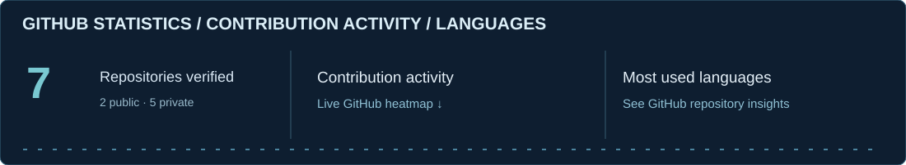

<table><tr>
<td width="33%" valign="top"><b>GitHub Statistics</b>
<a href="https://github.com/EMON-721?tab=repositories">Repositories &amp; public project activity</a>
</td>
<td width="33%" valign="top"><b>Contribution Activity</b>
<a href="https://github.com/EMON-721?tab=overview">Live contribution calendar &amp; commit activity</a>
</td>
<td width="34%" valign="top"><b>Most Used Languages</b>
<a href="https://github.com/EMON-721?tab=repositories">Repository languages and breakdown</a>
</td>
</tr></table>

GitHub's native activity calendar below the profile README shows the actual history. No manually fabricated contribution counts, language percentages, stars or streaks are used.

---

<!-- ================ CONTACT, QUOTE, COLLABORATION AND OWNER TOOLS ================ -->
## 08 / Connect With Me · Open to Collaboration

> **Building Intelligent Solutions for a Better Tomorrow.**  
> — **Emon Hossain**

I'm interested in collaborative research discussions, AI/ML experiments, NLP and language models, Data Science and practical learning.

The + badges are working owner-edit links rather than guessed social accounts. Add each URL when you are ready to publish it.

### Customize Layout · Add / Edit / Reorder / Delete

<a href="https://github.com/EMON-721/EMON-721/edit/main/README.md">⚙ Customize Layout</a> · <a href="https://github.com/EMON-721/EMON-721/edit/main/README.md">✎ Edit All Sections</a> · <a href="https://github.com/settings/profile">Edit Native GitHub Profile</a>

<b>Owner controls · Future projects / research / awards / contacts</b>

<ul>
<li>Use <a href="https://github.com/EMON-721/EMON-721/edit/main/README.md">GitHub's README editor</a> to update any section marked by an HTML comment.</li>
<li>Add a research paper, certification, experience, another interest or project by copying the relevant section/card.</li>
<li>To add a project animation, create a new SVG under <code>assets/repos/</code> and add a project table entry.</li>
<li>Move a section to reorder or remove only that section to delete.</li>
<li>Keep the existing <code>assets/research-concept-map.svg</code> so the animated AI/ML/NLP/Big Data/Data Science flow remains unchanged.</li>
<li>Use <a href="https://github.com/settings/profile">native GitHub Settings → Profile</a> for the actual GitHub account photo, Name, Bio, location or native social fields. These settings cannot be changed by editing the README.</li>
</ul>

GitHub profile READMEs support animated SVG and expandable sections but do not run custom JavaScript tabs, CMS edit pop-ups or draggable cards.

LEARN → RESEARCH → BUILD → EVALUATE → IMPROVE · EMON-721

