<!--
  EMON-721 / EMON-721 — public GitHub profile README
  Research Interface v4 — updated 25 October 2026.
  Every section below is deliberately editable. See EDITING_GUIDE.md.
  IMPORTANT: Do not publish private repositories, credentials, financial data,
  transcripts, or unverified publication / contribution figures in this public repo.
-->

<!-- ================ HERO: REAL PORTRAIT, ANIMATED DESIGN ================ -->
<table>
<tr>
<td width="72%" valign="top"></td>
<td width="28%" valign="middle" align="center">
<b>Emon Hossain</b> EMON-721 · CSE Student · Dhaka, Bangladesh
</td>
</tr>
</table>

**Computer Science & Engineering (CSE) Student | AI • ML • NLP • Data Science | Research-Driven**

Exploring how machines learn, understand language, and turn data into useful insights.

[**Featured Projects**](#05--featured-repositories--projects) · [**Research Flow**](#01--research--animated-concept-map) · [**About & Education**](#02--about-me--education--research-background) · [**Skills**](#04--technical-skills--tools) · [**Research Notes**](#06--research--publications) · [**Connect**](#08--connect-with-me--open-to-collaboration)

---

<!-- ================ RESEARCH CONCEPT MAP: EDIT assets/research-concept-map.svg ================ -->
## 01 / Research · Animated concept map

  
  Five rotating research modes · flowing signal paths · four stages and twelve nodes · conceptual visualization, not live model inference.

The connected-node flow is an **SVG concept illustration**, not a deployed AI model. Expand any subject below to see its stages. GitHub READMEs do not support custom JavaScript tabs.

<b>01 · Machine Learning — Input → Features → Model → Insight</b>

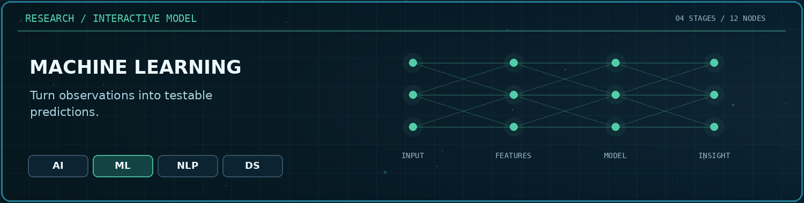

Experimentation, pattern discovery, evaluation, prediction, and explainability.

<b>02 · Artificial Intelligence — Data → Represent → Reason → Impact</b>

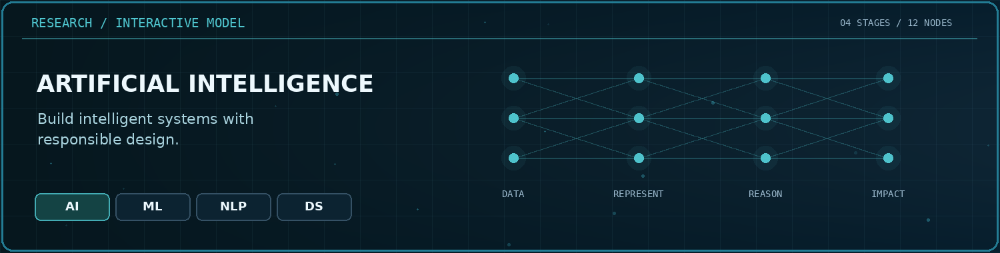

Applied intelligence, reasoning, human-centered AI and responsible systems.

<b>03 · Language & NLP — Text → Tokens → Context → Meaning</b>

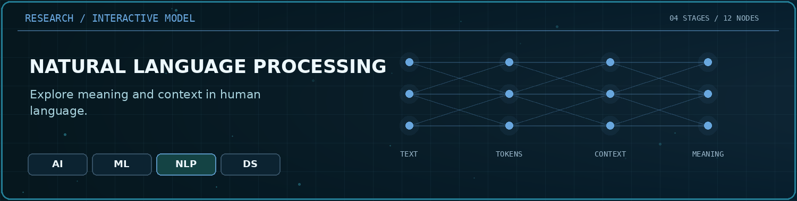

Text understanding, multilingual NLP, information retrieval, transformers and RAG.

<b>04 · Big Data — Ingest → Store → Process → Insight</b>

Data engineering at scale: structured/unstructured sources, distributed storage, batch/stream processing, quality checks, and analysis. The five-mode animated concept map above includes this Big Data flow.

<b>05 · Data Science — Collect → Clean → Analyse → Impact</b>

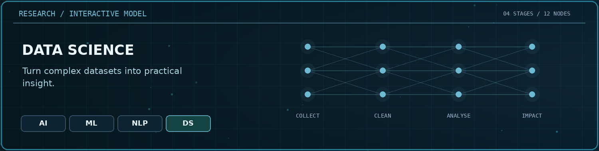

Statistical inquiry, feature analysis, useful visualizations and reproducible evidence.

<b>Previous research cycle · optional archive</b>

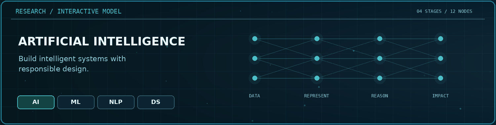

**[Edit research content](https://github.com/EMON-721/EMON-721/edit/main/README.md)** · **[Manage animation source](https://github.com/EMON-721/EMON-721/blob/main/assets/research-concept-map.svg)**

---

<!-- ================ ABOUT / EDUCATION / RESEARCH: EDITABLE ================ -->
## 02 / About Me · Education · Research Background

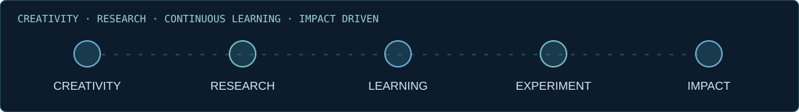

<table><tr><td width="33%" valign="top">
<h3>About Me</h3>

I'm <b>Emon Hossain</b>, a <b>Computer Science &amp; Engineering (CSE) student</b>. My interests and academic work focus primarily on <b>Artificial Intelligence, Machine Learning, Natural Language Processing and Data Science</b>.

I explore research questions through datasets, experiments and practical evaluation. I have also completed software-engineering coursework; my primary direction remains research rather than a full-stack developer role.

Creativity · Research-oriented · Continuous learner · Impact-driven

<a href="https://github.com/EMON-721/EMON-721/edit/main/README.md">✎ Edit · ＋ Add Strength</a>

</td><td width="34%" valign="top">
<h3>Education</h3>
 

<b>B.Sc. in Computer Science &amp; Engineering</b> University of Liberal Arts Bangladesh (ULAB) Dhaka, Bangladesh · <b>In progress</b>

<a href="https://github.com/EMON-721/EMON-721/edit/main/README.md">✎ Update · ＋ Add Education</a>

</td><td width="33%" valign="top">
<h3>Research Background</h3>

My focus is evaluating computational ideas with usable datasets, clear baselines and reproducible methods. I am particularly interested in reliable results, language and information retrieval, and practical data-driven systems.

Research approach: Question → Dataset → Baseline → Evaluation → Error analysis → Reporting

<a href="#06--research--publications">Research and publications ↗</a>

</td></tr></table>

---

<!-- ================ INTERESTS & CURRENT FOCUS ================ -->
## 03 / Interests · Research Directions

<code>Artificial Intelligence</code> · <code>Machine Learning</code> · <code>Language &amp; NLP</code> · <code>Data Science</code> · <code>Big Data</code> · <code>Deep Learning</code> · <code>Information Retrieval</code> · <code>Applied Research</code> · <code>Responsible AI</code> · <code>Sustainability</code>

<table><tr><td width="50%" valign="top">
<h3>Current focus</h3>
<ul>
<li>Machine Learning training, testing and evaluation</li>
<li>Natural Language Processing, retrieval and RAG</li>
<li>Data analysis, cleaning and visualization</li>
<li>Publicly available datasets and research experiments</li>
</ul>
</td><td width="50%" valign="top">
<h3>Research interests</h3>
<ul>
<li>Multilingual and low-resource language technology</li>
<li>Intelligent systems and explainable results</li>
<li>Ethical AI and reproducible methods</li>
<li>AI applications for environmental and sustainability data</li>
</ul>
</td></tr></table>

<a href="https://github.com/EMON-721/EMON-721/edit/main/README.md">✎ Edit · ＋ Add Interest · ↕ Reorder</a>

---

<!-- ================ SKILLS & VERIFIED SELF-DESCRIBED TOOLS ================ -->
## 04 / Technical Skills · Tools

| Skills you identified | Research-related work |
| --- | --- |
| HTML5 · CSS3 · JavaScript · TypeScript | AI / ML · NLP · Data Science |
| Python · MySQL | Data handling · Model evaluation |
| Git · GitHub | Version control · Experiments |
| Jira · Atlassian | Project tracking and collaboration |
| Markdown · SVG | Technical documentation and animated GitHub profile cards |
| GitHub Actions | Familiarity with workflows present in project repositories |

**Research practices:** dataset cleaning, exploratory analysis, baseline comparison, evaluation metrics, error analysis and reproducible reporting. These describe areas of practice, not a claim of expert proficiency in every tool.

<a href="https://github.com/EMON-721/EMON-721/edit/main/README.md">✎ Edit · ＋ Add Skill · ↕ Reorder</a>

---

<!-- ================ PROJECTS: ALL CONNECTED REPOSITORIES, ANIMATED ================ -->
## 05 / Featured Repositories · Projects

The connected GitHub account currently shows **14 accessible repositories: 11 public and 3 private** (checked 1 November 2026). Thirteen are featured below; the additional public `local-services` repository remains accessible from [All Repositories](https://github.com/EMON-721?tab=repositories). Repository visibility can change; this is a dated snapshot, not a live counter.

<b>Compact project directory · easy to navigate on mobile</b>

- [Emon Portfolio](https://github.com/EMON-721/Emon-Portfolio)
- [Mouchak AI](https://github.com/EMON-721/Mouchak-AI-platform)
- [Campus to Country](https://github.com/EMON-721/campus-to-country)
- [FixBari](https://github.com/EMON-721/FixBari)
- [VisaFund](https://github.com/EMON-721/visafund)
- [Vocab Station](https://github.com/EMON-721/vocab-station)
- [Speaking Station](https://github.com/EMON-721/Speak-Station)
- [GoliCoach AI](https://github.com/EMON-721/Goli-Coach)
- [The Passport Band](https://github.com/EMON-721/The-Passport-Band) *(private source)*
- [Italy Journey](https://github.com/EMON-721/italy-journey-portal) *(private source)*
- [Emon's MS Journey](https://github.com/EMON-721/Emon-s-MS-Journey) *(private source)*
- [GitHub Research Profile](https://github.com/EMON-721/EMON-721)
- [Service Lagbe](https://github.com/EMON-721/Service-Lagbe)

<table>
<tr><td width="50%" valign="top"><a href="https://github.com/EMON-721/Emon-Portfolio">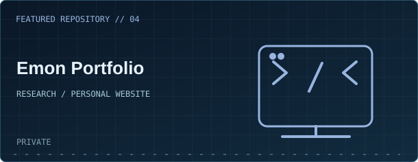</a>
<b><a href="https://github.com/EMON-721/Emon-Portfolio">Emon Portfolio</a></b> · Public

Personal research portfolio, selected work and editable content.

<a href="https://github.com/EMON-721/Emon-Portfolio">⌘ Source repository</a> · <a href="https://emon-portfolio-blond.vercel.app">🌐 Visit Website</a> (Website · access may require sign-in)
</td><td width="50%" valign="top"><a href="https://github.com/EMON-721/Mouchak-AI-platform">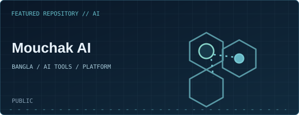</a>
<b><a href="https://github.com/EMON-721/Mouchak-AI-platform">Mouchak AI</a></b> · Public

Bangla–English AI tool platform with specialized workspaces.

<a href="https://github.com/EMON-721/Mouchak-AI-platform">⌘ Source repository</a>
</td></tr>
<tr><td width="50%" valign="top"><a href="https://github.com/EMON-721/campus-to-country">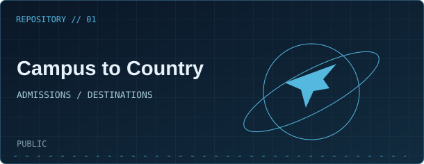</a>
<b><a href="https://github.com/EMON-721/campus-to-country">Campus to Country</a></b> · Public

Country and university research, comparison and application planning.

<a href="https://github.com/EMON-721/campus-to-country">⌘ Source repository</a> · <a href="https://campus-to-country.vercel.app">🌐 Visit Website</a> (Website · access may require sign-in)
</td><td width="50%" valign="top"><a href="https://github.com/EMON-721/FixBari">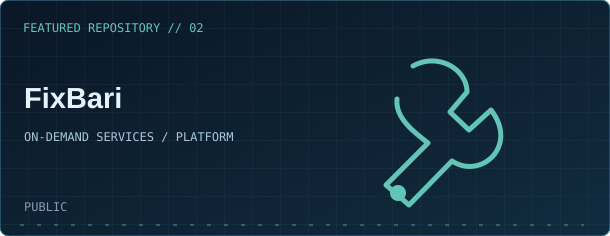</a>
<b><a href="https://github.com/EMON-721/FixBari">FixBari</a></b> · Public

On-demand services, bookings and local service-provider workflows.

<a href="https://github.com/EMON-721/FixBari">⌘ Source repository</a> · <a href="https://fix-bari.vercel.app">🌐 Visit Website</a> (Website · access may require sign-in)
</td></tr>
<tr><td width="50%" valign="top"><a href="https://github.com/EMON-721/visafund">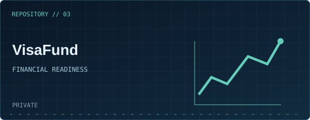</a>
<b><a href="https://github.com/EMON-721/visafund">VisaFund</a></b> · Public

Funding preparation, financial planning and readiness tools.

<a href="https://github.com/EMON-721/visafund">⌘ Source repository</a> · <a href="https://visafund.fundhub.workers.dev">🌐 Visit Website</a> (Website · availability unverified)
</td><td width="50%" valign="top"><a href="https://github.com/EMON-721/vocab-station">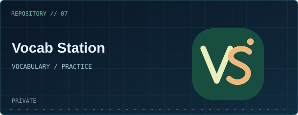</a>
<b><a href="https://github.com/EMON-721/vocab-station">Vocab Station</a></b> · Public

Vocabulary practice, mock tests, revision and progress tracking.

<a href="https://github.com/EMON-721/vocab-station">⌘ Source repository</a> · <a href="https://vocab-station.emon721.workers.dev">🌐 Visit Website</a> (Website · sign-in may be required)
</td></tr>
<tr><td width="50%" valign="top"><a href="https://github.com/EMON-721/Speak-Station">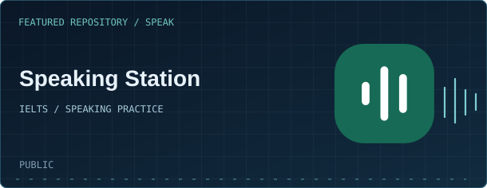</a>
<b><a href="https://github.com/EMON-721/Speak-Station">Speaking Station</a></b> · Public

IELTS speaking questions, recording practice and AI feedback.

<a href="https://github.com/EMON-721/Speak-Station">⌘ Source repository</a> · <a href="https://speak-station-emon.emonhossain5081.chatgpt.site/">🌐 Visit Website</a> (Website)
</td><td width="50%" valign="top"><a href="https://github.com/EMON-721/Goli-Coach">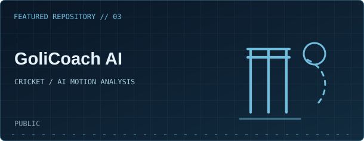</a>
<b><a href="https://github.com/EMON-721/Goli-Coach">GoliCoach AI</a></b> · Public

AI-assisted cricket practice and pose-analysis feedback.

<a href="https://github.com/EMON-721/Goli-Coach">⌘ Source repository</a>
</td></tr>
<tr><td width="50%" valign="top">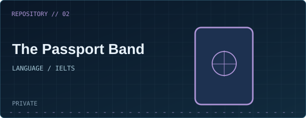
<b>The Passport Band</b> · Private

IELTS Academic practice, vocabulary and learning resources.

Source code restricted · <a href="https://emon-ielts-studio.emonhossain5081.chatgpt.site">🌐 Visit Website</a> (Website · restricted)
</td><td width="50%" valign="top">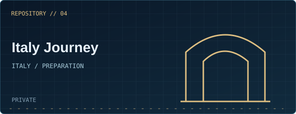
<b>Italy Journey</b> · Private

Italy admissions research and planning tools.

Source code restricted
</td></tr>
<tr><td width="50%" valign="top">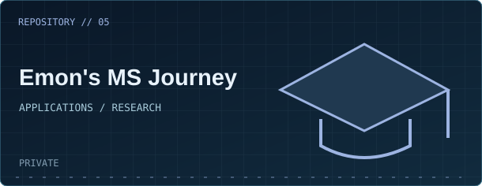
<b>Emon's MS Journey</b> · Private

Personal master's application milestones and research planning.

Source code restricted
</td><td width="50%" valign="top"><a href="https://github.com/EMON-721/EMON-721">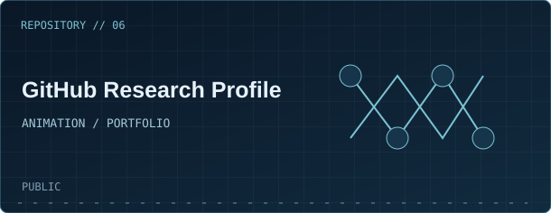</a>
<b><a href="https://github.com/EMON-721/EMON-721">GitHub Research Profile</a></b> · Public

GitHub overview, research concept maps and animated project cards.

<a href="https://github.com/EMON-721/EMON-721">⌘ Source repository</a> · <a href="https://github.com/EMON-721">🌐 View Profile</a> (Public profile)
</td></tr>
<tr><td width="50%" valign="top"><a href="https://github.com/EMON-721/Service-Lagbe">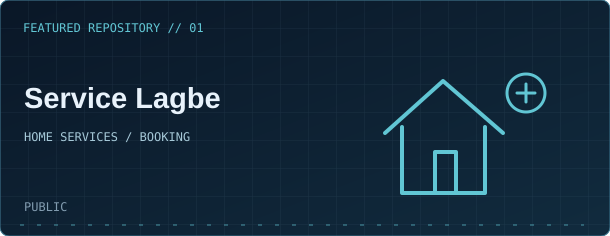</a>
<b><a href="https://github.com/EMON-721/Service-Lagbe">Service Lagbe</a></b> · Public

Home-service discovery and booking workflows.

<a href="https://github.com/EMON-721/Service-Lagbe">⌘ Source repository</a>
</td><td width="50%" valign="top">
<b>＋ Add New Project</b>

More projects can be added without replacing existing cards.

<a href="https://github.com/EMON-721/EMON-721/edit/main/README.md">Owner: Add / Edit / Reorder</a>
</td></tr>
</table>

<b>＋ Future projects, coursework &amp; owner editing</b>

- **Add New Project:** Add a public repository, coursework project, research experiment or application when available.
- **Future Project Slot:** Additional verified projects can be included without altering animations.
- **Software Engineering Coursework:** Completed coursework can be documented once its repository and details are confirmed.
- **＋ Future Project Slot:** Reuse the existing SVG-card template for new projects.
- **Edit / Reorder:** [Open README editor](https://github.com/EMON-721/EMON-721/edit/main/README.md).

All 13 existing project covers and links remain. Private repository code is not embedded or exposed. No unverified stars, forks or publication figures are shown.

---

<!-- ================ PUBLICATIONS: KEEP ONLY VERIFIED SOURCES ================ -->
## 06 / Research & publications

**Research directions:** Artificial Intelligence · Machine Learning · Language & NLP · Data Science · Big Data · Intelligent Systems · Sustainability.

**Research practice:** begin with a clear question, document data provenance, establish a baseline, select appropriate evaluation metrics, inspect limitations and report reproducible findings.

**Publications:** a bibliography is intentionally not displayed at this stage. No unverified publication counts or results are claimed.

<b>Research updates · owner-maintained</b>

Research notes, thesis progress and verified sources can be added later without changing the layout. <a href="https://github.com/EMON-721/EMON-721/edit/main/README.md">Edit research section</a>.

---

<!-- ================ GITHUB STATISTICS, CONTRIBUTIONS AND LANGUAGES ================ -->
## 07 / GitHub Statistics · Contribution Activity · Most Used Languages

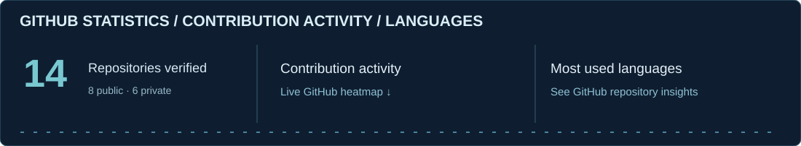

<table><tr>
<td width="33%" valign="top"><b>GitHub Statistics</b>
<a href="https://github.com/EMON-721?tab=repositories">Verified repository directory</a>
</td>
<td width="33%" valign="top"><b>Contribution Activity</b>
<a href="https://github.com/EMON-721?tab=overview">Live contribution calendar &amp; commit activity</a>
</td>
<td width="34%" valign="top"><b>Most Used Languages</b>
<a href="https://github.com/EMON-721?tab=repositories">Repository languages and breakdown</a>
</td>
</tr></table>

Repository counts above are a snapshot from 1 November 2026. GitHub's native activity calendar displays actual contributions; languages differ by repository and are not fabricated into a single percentage chart. Public repositories and visibility may change.

---

<!-- ================ CONTACT, QUOTE, COLLABORATION AND OWNER TOOLS ================ -->
## 08 / Connect With Me · Open to Collaboration

> **Building Intelligent Solutions for a Better Tomorrow.**  
> — **Emon Hossain**

I'm interested in collaborative research discussions, AI/ML experiments, NLP and language models, Data Science and practical learning.

<b>Other contact channels · not configured yet</b>

LinkedIn · WhatsApp · Email · X — placeholders retained for future verified links; they no longer misdirect visitors to the README editor. [Edit contact links](https://github.com/EMON-721/EMON-721/edit/main/README.md).

Only confirmed GitHub and Portfolio links are clickable. Other contact channels can be added after their URLs are confirmed.

### Customize Layout · Add / Edit / Reorder / Delete

<a href="https://github.com/EMON-721/EMON-721/edit/main/README.md">⚙ Customize Layout</a> · <a href="https://github.com/EMON-721/EMON-721/edit/main/README.md">✎ Edit All Sections</a> · <a href="https://github.com/settings/profile">Edit Native GitHub Profile</a>

<b>Owner controls · Future projects / research / awards / contacts</b>

<ul>
<li>Use <a href="https://github.com/EMON-721/EMON-721/edit/main/README.md">GitHub's README editor</a> to update any section marked by an HTML comment.</li>
<li>Add a research paper, certification, experience, another interest or project by copying the relevant section/card.</li>
<li>To add a project animation, create a new SVG under <code>assets/repos/</code> and add a project table entry.</li>
<li>Move a section to reorder or remove only that section to delete.</li>
<li>Keep the existing <code>assets/research-concept-map.svg</code> so the animated AI/ML/NLP/Big Data/Data Science flow remains unchanged.</li>
<li>Use <a href="https://github.com/settings/profile">native GitHub Settings → Profile</a> for the actual GitHub account photo, Name, Bio, location or native social fields. These settings cannot be changed by editing the README.</li>
</ul>

GitHub profile READMEs support animated SVG and expandable sections but do not run custom JavaScript tabs, CMS edit pop-ups or draggable cards.

LEARN → RESEARCH → BUILD → EVALUATE → IMPROVE · EMON-721

