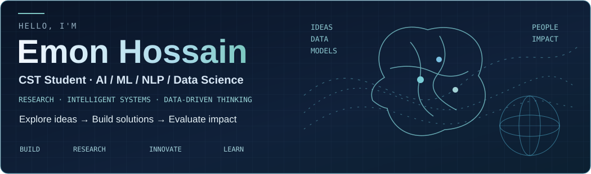
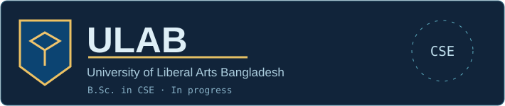
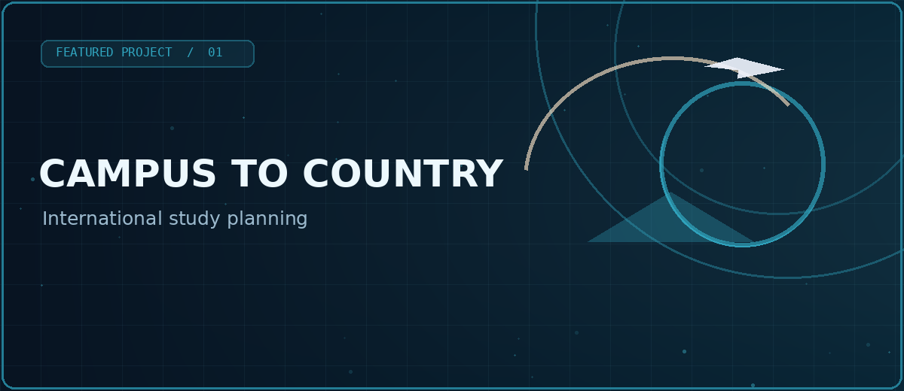
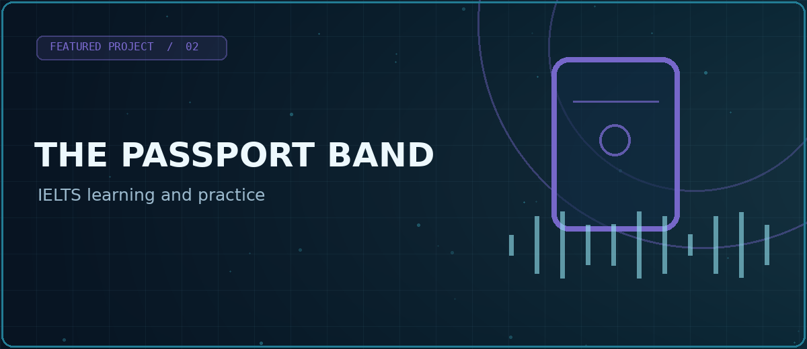
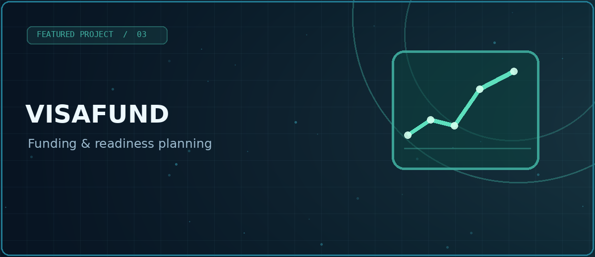
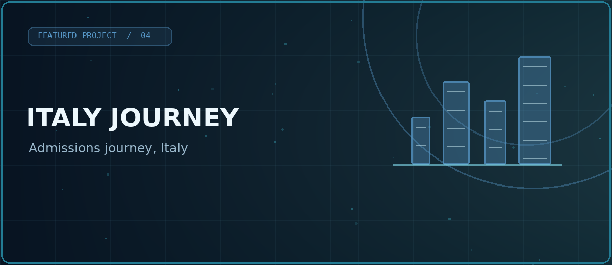
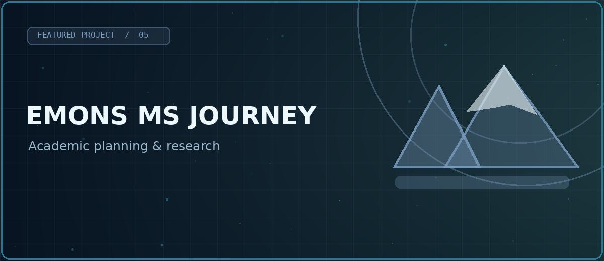

<!--
  EMON-721 / EMON-721 — public GitHub profile README
  Research Interface v2 — designed 25 October 2026.
  Every section below is deliberately editable. See EDITING_GUIDE.md.
  IMPORTANT: Do not publish private repositories, credentials, financial data,
  transcripts, or unverified publication / contribution figures in this public repo.
-->

<!-- ================ HERO: REAL PORTRAIT, ANIMATED DESIGN ================ -->
<table>
<tr>
<td width="78%" valign="middle"></td>
<td width="22%" valign="middle" align="center">
<b>Emon Hossain</b> EMON-721 · Dhaka, Bangladesh
</td>
</tr>
</table>

**CSE Student | AI • ML • NLP • Data Science | Research-Driven**

Exploring how machines learn, understand language, and turn data into useful insights.

[**Build / Projects**](https://github.com/EMON-721?tab=repositories) · [**Research**](#01--research--animated-concept-map) · [**Learn & Innovate**](#03--interests--current-focus) · [**Collaborate**](#08--connect--collaboration)

---

<!-- ================ RESEARCH CONCEPT MAP: EDIT assets/research-concept-map.svg ================ -->
## 01 / Research · Animated concept map

  
  Five rotating research modes · flowing signal paths · four stages and twelve nodes · conceptual visualization, not live model inference.

The concept map uses **SVG animation without JavaScript**, with an always-visible connected-node flow inspired by the earlier reference. GitHub profile READMEs cannot run interactive React or JavaScript tabs, so use the expanding panels below to view a specific subject on demand.

<b>01 · Machine Learning — Input → Features → Model → Insight</b>

Experimentation, pattern discovery, evaluation, prediction, and explainability.

<b>02 · Artificial Intelligence — Data → Represent → Reason → Impact</b>

Applied intelligence, reasoning, human-centered AI and responsible systems.

<b>03 · Language & NLP — Text → Tokens → Context → Meaning</b>

Text understanding, multilingual NLP, information retrieval, transformers and RAG.

<b>04 · Big Data — Ingest → Store → Process → Insight</b>

Data engineering at scale: structured/unstructured sources, distributed storage, batch/stream processing, quality checks, and analysis. The five-mode animated concept map above includes this Big Data flow.

<b>05 · Data Science — Collect → Clean → Analyse → Impact</b>

Statistical inquiry, feature analysis, useful visualizations and reproducible evidence.

<b>Previous research cycle · optional archive</b>

**[Edit research content](https://github.com/EMON-721/EMON-721/edit/main/README.md)** · **[Manage animation source](https://github.com/EMON-721/EMON-721/blob/main/assets/research-concept-map.svg)**

---

<!-- ================ ABOUT / EDUCATION / RESEARCH: EDITABLE ================ -->
## 02 / About Me · Education · Research Background

<table><tr><td width="33%" valign="top">
<h3>About Me</h3>

I'm <b>Emon Hossain</b>, a <b>Computer Science &amp; Engineering (CSE) student</b>. My interests and academic work focus primarily on <b>Artificial Intelligence, Machine Learning, Natural Language Processing and Data Science</b>.

I enjoy exploring research problems, testing ideas, working with data and building intelligent solutions. I completed a software engineering coursework project, but software development is not my primary specialization.

Creativity · Research-oriented · Continuous learner · Impact-driven

<a href="https://github.com/EMON-721/EMON-721/edit/main/README.md">✎ Edit · ＋ Add Strength</a>

</td><td width="34%" valign="top">
<h3>Education</h3>

<b>B.Sc. in Computer Science &amp; Engineering</b> University of Liberal Arts Bangladesh (ULAB) Dhaka, Bangladesh · <b>In progress</b>

<a href="https://github.com/EMON-721/EMON-721/edit/main/README.md">✎ Update · ＋ Add Education</a>

</td><td width="33%" valign="top">
<h3>Research Background</h3>

My research interests involve how machines learn patterns from data, how language models process information, and how datasets can support reproducible experiments and useful decisions.

Core directions: <b>AI/ML model evaluation, NLP and retrieval/RAG, multilingual language processing, exploratory Data Science, responsible AI</b> and sustainability-related datasets.

<a href="#06--research--publications">Research and publications ↗</a>

</td></tr></table>

---

<!-- ================ INTERESTS & CURRENT FOCUS ================ -->
## 03 / Interests · Research Directions

<code>Artificial Intelligence</code> · <code>Machine Learning</code> · <code>Language &amp; NLP</code> · <code>Data Science</code> · <code>Big Data</code> · <code>Deep Learning</code> · <code>Information Retrieval</code> · <code>Applied Research</code> · <code>Responsible AI</code> · <code>Sustainability</code>

<table><tr><td width="50%" valign="top">
<h3>Current focus</h3>
<ul>
<li>Machine Learning training, testing and evaluation</li>
<li>Natural Language Processing, retrieval and RAG</li>
<li>Data analysis, cleaning and visualization</li>
<li>Publicly available datasets and research experiments</li>
</ul>
</td><td width="50%" valign="top">
<h3>Research interests</h3>
<ul>
<li>Multilingual and low-resource language technology</li>
<li>Intelligent systems and explainable results</li>
<li>Ethical AI and reproducible methods</li>
<li>AI applications for environmental and sustainability data</li>
</ul>
</td></tr></table>

<a href="https://github.com/EMON-721/EMON-721/edit/main/README.md">✎ Edit · ＋ Add Interest · ↕ Reorder</a>

---

<!-- ================ SKILLS & VERIFIED SELF-DESCRIBED TOOLS ================ -->
## 04 / Technical Skills · Tools

| Skills you identified | Research-related work |
| --- | --- |
| HTML5 · CSS3 · JavaScript · TypeScript | AI / ML · NLP · Data Science |
| Python · MySQL | Data handling · Model evaluation |
| Git · GitHub | Version control · Experiments |
| Jira · Atlassian | Project tracking and collaboration |

My main focus is research in AI/ML, NLP and Data Science; the technical stack reflects skills and tools rather than a claim to be a full-stack developer.

<a href="https://github.com/EMON-721/EMON-721/edit/main/README.md">✎ Edit · ＋ Add Skill · ↕ Reorder</a>

---

<!-- ================ PROJECTS: 5 COVERS, PRIVATE LINKS NOT EXPOSED ================ -->
## 05 / Featured projects

<table>
<tr><td width="50%" valign="top">
<b><a href="https://github.com/EMON-721/campus-to-country">Campus to Country</a></b>

A unified destination and application-planning platform for study-abroad research.
Public repo · Platform · Education</td><td width="50%" valign="top">
<b>The Passport Band</b>

IELTS learning, practice, vocabulary and progress tracking.
Private source · Language Learning</td></tr>
<tr><td width="50%" valign="top">
<b>VisaFund</b>

Personal funding planning, account tracking and financial readiness.
Private source · Finance Planning</td><td width="50%" valign="top">
<b>Italy Journey</b>

Information and personal planning workflows for Italy admissions.
Private source · Planning</td></tr>
<tr><td width="50%" valign="top">
<b>Emon's MS Journey</b>

Application tracking and milestone management for master's study planning.
Private source · Personal Planner</td>
<td width="50%" valign="top"><h3>＋ Add New Project</h3>
New projects, demos and verified public links can be added here over time.

<a href="https://github.com/EMON-721/EMON-721/edit/main/README.md">Edit Project Cards ↗</a>
</td></tr>
</table>

All five projects are listed. Only Campus to Country has a verified public code link; the other four repositories are private. Project cover graphics are illustrative.

---

<!-- ================ PUBLICATIONS: KEEP ONLY VERIFIED SOURCES ================ -->
## 06 / Research & publications

**Research directions:** Artificial Intelligence · Machine Learning · Language & NLP · Data Science · Big Data · Intelligent Systems · Sustainability.

I explore research questions, practical evaluations and dataset-based experimentation. Publication records will be displayed here after verifying official paper titles, author details, venues and DOIs; no unverified publication numbers are shown.

<b>＋ Add Verified Papers / Thesis / Research Projects</b>

Keep title, date, venue and DOI together with links to public datasets, code and results where available. <a href="https://github.com/EMON-721/EMON-721/edit/main/README.md">Edit entries</a>.

---

<!-- ================ GITHUB STATS: GROUNDED LINKS AND DYNAMIC FOLLOWERS ================ -->
## 07 / GitHub Snapshot · Contributions · Most Used Languages

<table><tr>
<td width="33%" valign="top"><b>GitHub Statistics</b>
<a href="https://github.com/EMON-721?tab=repositories">Repositories and project activity</a>
</td>
<td width="33%" valign="top"><b>Contribution Activity</b>
<a href="https://github.com/EMON-721?tab=overview">Live native GitHub calendar</a>
</td>
<td width="34%" valign="top"><b>Most Used Languages</b>
<a href="https://github.com/EMON-721?tab=repositories">Repository language details</a>
</td>
</tr></table>

Contributions, stars and language percentages are not hard-coded or fabricated. GitHub provides the current values.

---

<!-- ================ CONTACT / SOCIAL PLACEHOLDERS / OWNER EDITING ================ -->
## 08 / Connect · Collaboration

> **Building intelligent solutions for a better tomorrow.**

I'm open to thoughtful discussions about research, intelligent systems, machine learning, Language & NLP, and data science.

**GitHub:** [EMON-721](https://github.com/EMON-721) · **Public Work:** [Repositories](https://github.com/EMON-721?tab=repositories)

**Future Contact Links:** LinkedIn · WhatsApp · Portfolio · ResearchGate / ORCID · Email · X / Twitter. These fields are intentionally reserved, not filled with invented links.

<b>＋ Add Social Links / More Information</b>

Use the <a href="https://github.com/EMON-721/EMON-721/edit/main/README.md">GitHub README editor</a> to insert verified public addresses, new sections, research papers, awards, certifications, projects or a resume when ready.

<b>Owner Controls — Add / Edit / Update / Reorder / Delete</b>

<a href="https://github.com/EMON-721/EMON-721/edit/main/README.md">Edit README</a> · <a href="https://github.com/EMON-721/EMON-721/blob/main/EDITING_GUIDE.md">Editing Guide</a>

<ol><li>Locate the labelled HTML comment for the section to change.</li><li>Update content, copy project cards to add more, move blocks to reorder, remove only unwanted blocks to delete.</li><li>Keep the original five-mode animated research flow in <code>assets/research-concept-map.svg</code>.</li><li>Replace the portrait image only by uploading an approved real photo under the same filename.</li><li>Commit changes to update your GitHub Overview.</li></ol>

<b>Note:</b> GitHub READMEs support animated SVG but not JavaScript-powered CMS controls or clickable animated-mode tabs.

Learn → Research → Build → Evaluate → Improve
