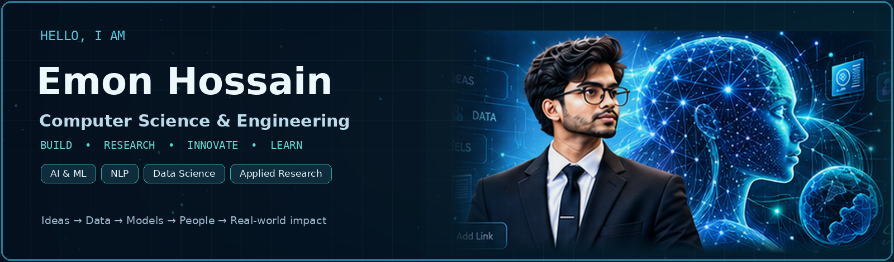
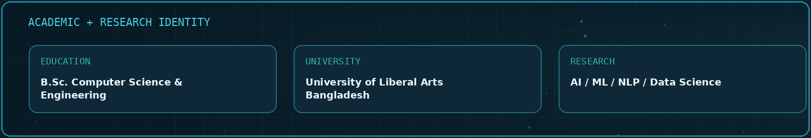

<!--
  EMON-721 / EMON-721 — public GitHub profile README
  Research Interface v2 — designed 25 October 2026.
  Every section below is deliberately editable. See EDITING_GUIDE.md.
  IMPORTANT: Do not publish private repositories, credentials, financial data,
  transcripts, or unverified publication / contribution figures in this public repo.
-->

<!-- ================ HERO: EDIT / REPLACE assets/hero.png ================ -->

  

  
  
  

  **Build • Research • Innovate • Learn • Contribute**

  Computer Science & Engineering · Dhaka, Bangladesh · Open to research and collaboration

---

<!-- ================ RESEARCH MODEL: ALL 4 MODES EDITABLE ================ -->
## 01 / Research · Interactive model

  

GitHub README files do not run custom JavaScript. This panel **cycles automatically** through four topics; open any individual mode below for a detailed model view. It is a conceptual pipeline visualization, not a deployed neural-network inference system.

<b>01 · Artificial Intelligence — Data → Represent → Reason → Impact</b>

 

Applied AI, intelligent systems, reasoning, evaluation and responsible development.

<b>02 · Machine Learning — Input → Features → Model → Insight</b>

 

Dataset design, predictive models, experimentation and interpretable results.

<b>03 · Natural Language Processing — Text → Tokens → Context → Meaning</b>

 

Language models, multilingual and low-resource NLP, information retrieval and RAG.

<b>04 · Data Science — Collect → Clean → Analyse → Impact</b>

 

Turning evidence into explainable findings, useful visuals and practical decisions.

---

<!-- ================ ABOUT, EDUCATION, RESEARCH: EDIT HERE ================ -->
## 02 / About me · Education · Research background

<table>
<tr>
<td width="33%" valign="top">

### About me

I'm **Emon Hossain**, a Computer Science & Engineering student interested in research-driven software and intelligent systems. I enjoy turning complex ideas into practical applications and testing them against real problems.

**How I work:** Learn → Research → Build → Evaluate → Improve.

</td>
<td width="34%" valign="top">

### Education

**B.Sc. in Computer Science & Engineering**

University of Liberal Arts Bangladesh (**ULAB**), Dhaka.

**Academic focus:** Computing, AI/ML, NLP and data-oriented problem solving.

</td>
<td width="33%" valign="top">

### Research background

I'm interested in **Artificial Intelligence**, **Natural Language Processing**, **Data Science** and applied research, especially public-dataset-based projects, information retrieval and real-world impact.

[Add verified papers and DOIs below](#05--research--publications).

</td>
</tr>
</table>

---

<!-- ================ INTERESTS: ADD MORE ROWS OR ITEMS ================ -->
## 03 / Interests · Current focus

| Intelligence & Data | Engineering & Impact |
| --- | --- |
| Artificial Intelligence · Machine Learning | Full-stack intelligent applications |
| NLP · Language models · Retrieval / RAG | Human-centered interfaces and systems |
| Data Science · Analysis · Visualization | Research methods and reproducible evaluation |
| Deep Learning · Responsible AI | AI for education and sustainability |

**Currently working on:** Integrated learning platforms, study-planning tools, financial planning systems, research-oriented software, and exploring AI/NLP projects using openly available datasets.

---

<!-- ================ TECH STACK: EDIT NAMES TO MATCH REAL SKILLS ================ -->
## 04 / Technical skills · Tools

**Programming:** Python · JavaScript · TypeScript · SQL · HTML · CSS

**Web & application development:** React · Next.js · Git · GitHub · APIs

**Data & research:** Data preparation · ML experimentation · NLP · Retrieval / RAG concepts

**Developer ecosystem:** Supabase · Vercel · PostgreSQL · Testing and version control

These are areas in my development and learning ecosystem; this is not a claim of expert proficiency in every tool.

---

<!-- ================ PROJECTS: CAN ADD/REMOVE/REORDER INDIVIDUAL CARDS ================ -->
## 05 / Featured projects

Project images below are original stylized covers. A project appearing here does **not** mean its source code is publicly accessible. Links are shown only for projects confirmed public.

<table>
<tr>
<td width="50%" valign="top">

**[Campus to Country](https://github.com/EMON-721/campus-to-country)**

A planning platform for destinations, applications and study-abroad workflows. **Public repository.**

</td>
<td width="50%" valign="top">

**The Passport Band**

IELTS Academic preparation, practice, vocabulary and progress tracking. **Private source.**

</td>
</tr>
<tr>
<td valign="top">

**VisaFund**

Financial planning, savings, proof-of-funds organization and readiness tools. **Private source.**

</td>
<td valign="top">

**Italy Journey**

Admissions and preparation journey information and personal planning tools. **Private source.**

</td>
</tr>
<tr>
<td valign="top">

**Emon’s MS Journey**

Personal master’s-application planning, documentation and progress tracking. **Private source.**

</td>
<td valign="top">

### + Next project

New project coming soon.

To add one, duplicate any project card in this section, add a new `assets/project-...png` image, write its summary and add a **verified public** repository/demo link when ready.

**[Edit projects](https://github.com/EMON-721/EMON-721/edit/main/README.md)**

</td>
</tr>
</table>

---

<!-- ================ VERIFIED PUBLICATIONS: NO INVENTED CITATIONS ================ -->
## 06 / Research & publications

**Areas:** AI, NLP, Data Science, applied intelligent systems and AI for sustainability.

Research-paper metadata should be added here only after checking the official title, authorship, venue and DOI. This prevents inaccurate publication claims.

<!-- TEMPLATE (duplicate as needed):
- **Full paper title** — Authors, Venue, Year. [DOI](https://doi.org/...) · [Code](https://github.com/...)
-->

---

<!-- ================ REAL-TIME ACTIVITY: GITHUB-NATIVE LINKS ================ -->
## 07 / GitHub snapshot · Contributions · Languages

<table>
<tr>
<td valign="top" width="33%"><b>Contributions & activity</b> <a href="https://github.com/EMON-721?tab=overview">See GitHub's actual contribution graph</a></td>
<td valign="top" width="33%"><b>Repositories & projects</b> <a href="https://github.com/EMON-721?tab=repositories">Browse repositories and their languages</a></td>
<td valign="top" width="34%"><b>Recent changes</b> <a href="https://github.com/EMON-721">See GitHub's latest public activity</a></td>
</tr>
</table>

GitHub itself maintains the live heatmap, contribution history and repository language metadata. I intentionally avoid hardcoded streak totals, unverified star counts or third-party statistics images that might fail to load.

---

<!-- ================ CONTACT, QUOTE & FUTURE EDITING ================ -->
## 08 / Let's connect · Collaborate

> **"Building intelligent solutions for a better tomorrow."**

I'm interested in research conversations, collaborative projects and building systems that connect ideas, data, models and people.

[**GitHub profile**](https://github.com/EMON-721) · [**Explore my public repositories**](https://github.com/EMON-721?tab=repositories)

---

<b>Owner tools — Edit / Add / Reorder / Delete any section</b>

 

1. Open **[Edit README](https://github.com/EMON-721/EMON-721/edit/main/README.md)** while logged in as the repository owner.
2. Every editable section has a clearly labeled HTML comment. Change its text, duplicate blocks to **add** items, move blocks to **reorder**, or remove a block to **delete** it.
3. To replace a banner, model or project graphic, upload a new file inside `assets/` and update its filename in this README, or replace the existing file while keeping the same name.
4. Commit changes. GitHub updates the profile automatically after a successful commit.
5. Review `EDITING_GUIDE.md` for step-by-step editing and backup instructions.

GitHub profile READMEs do not support custom CMS controls, Javascript-powered tabs or draggable panels. Edit buttons in a visual mockup are only an illustration; source editing works reliably through GitHub's built-in editor.

Built with curiosity. Driven by evidence. Continuously improving.

